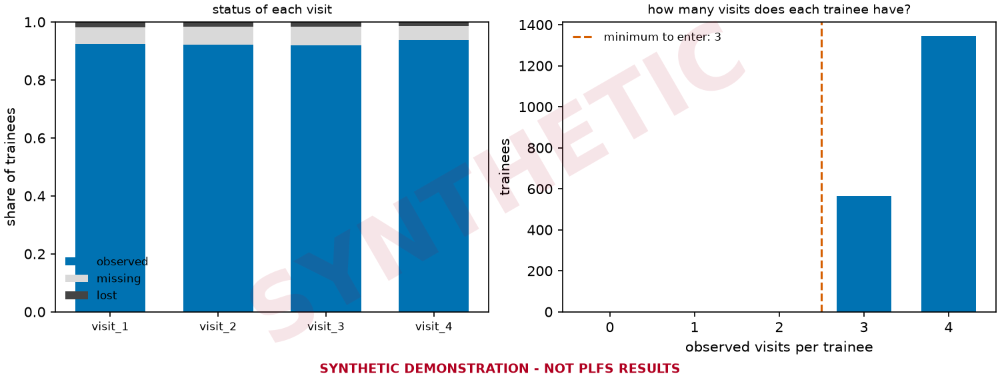
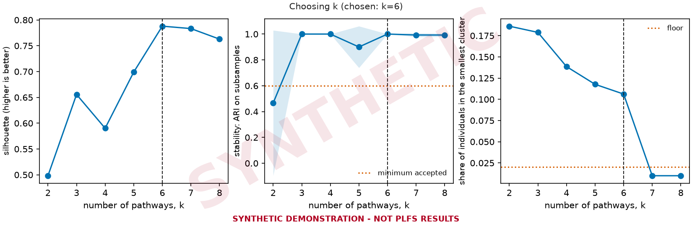
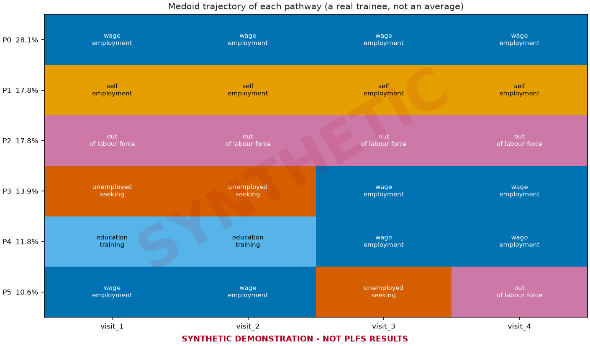
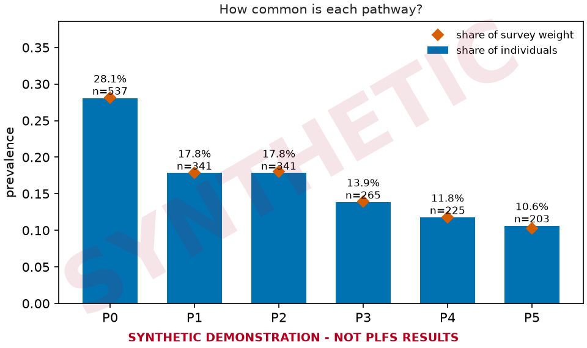
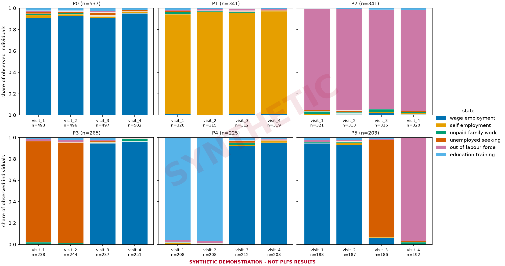
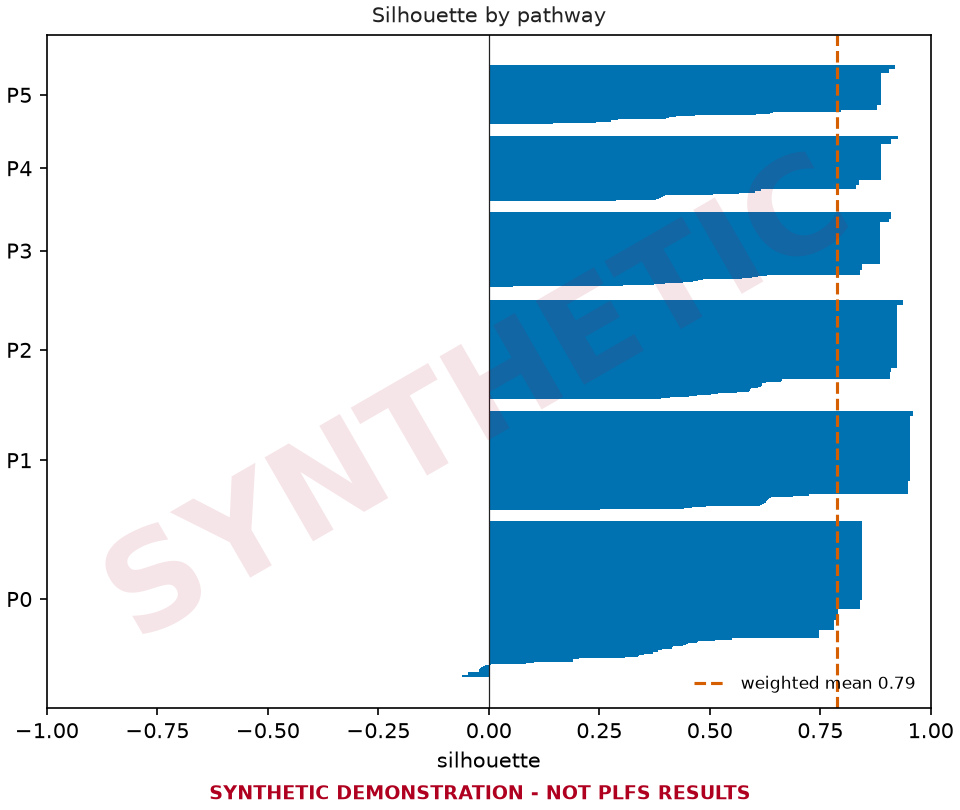
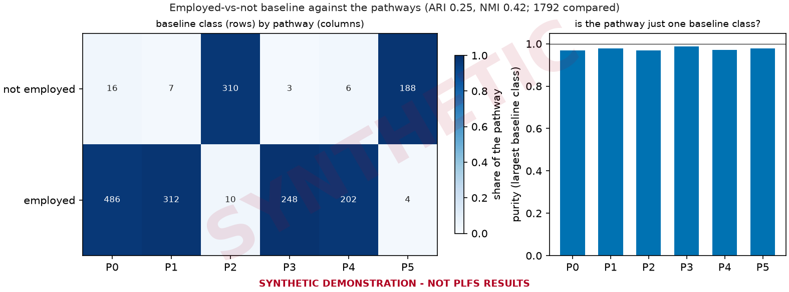
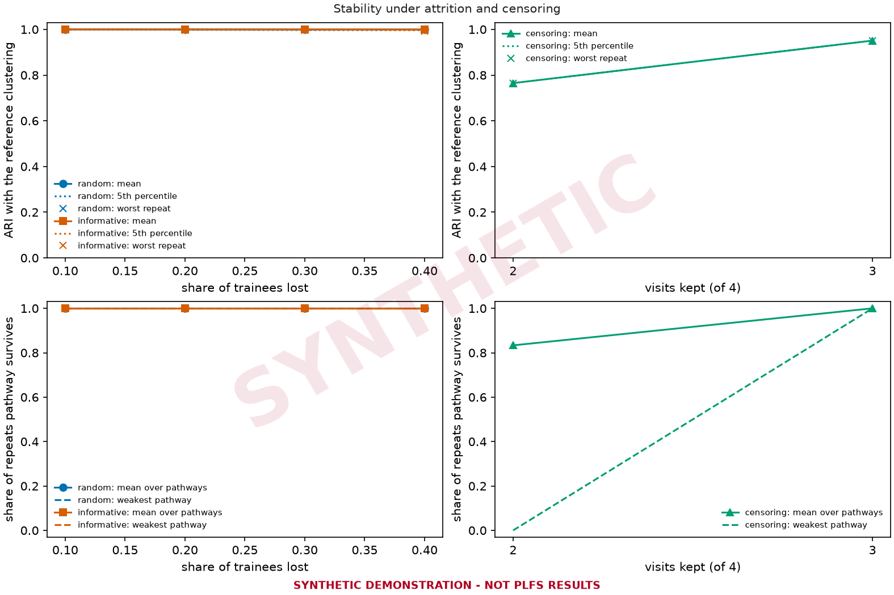

> **SYNTHETIC DEMONSTRATION - NOT PLFS RESULTS**

# Employment Outcome Pathway Grouping After Skilling

INT396 Unsupervised Learning, CA-1 project. Problem statement SIH26135 (Government of Maharashtra). Group G24.

<!-- How this file works. It contains words and placeholders only. Every number below is a double-brace placeholder
     (result name, then key), filled by src/report_builder.py from reports/results/. If a number is not a
     placeholder it does not belong here. Build with:  python -m src.report_builder  (or python run_pipeline.py).
     The sentences make no claim that depends on a result's direction; they point to the numbers and say how to read them. -->

## 1. What this report asks, and what it cannot say

The question is whether the people who reported vocational training fall into a small number of recognisable employment pathways over the visits in the data, and whether that grouping tells a skilling programme more than a simple "employed or not" split does.

Who is analysed: the trainee definition used is `ever_trained`, and the questionnaire's support for dating the training is recorded as `coarse_flag`. Unless that value is `dated`, the data do not say when the training happened relative to the visits, so the pathways below describe what trained people's employment looked like across the visits, not what happened after training. Nothing in this report is a causal claim about the effect of training.

How long a "pathway" is: each person is followed over 4 visits at most. A pattern over so few visits is a short-run pattern, not a career, and the word "pathway" is used in that limited sense throughout.

## 2. Data

The data plan is `synthetic`. The panel holds 2000 people; after the eligibility rule (at least 3 observed visits, where a missing or lost visit does not count) 1912 remain, so 88 were removed by that rule. Survey weights attached: yes. Weights are never used to form the pathways; counts of people are used throughout unless a table says otherwise.

Records by kind: observed state 7245, unknown 211, lost to follow-up 163.

The list of states and the visit labels are saved in the `data_summary` result and shown in the dashboard.

## 3. Missing data

Of 7648 person-visit cells, 92.6% are observed, 5.8% are missing and 1.6% are lost to follow-up. A missing or lost cell is never recoded into an employment state. 70.4% of trainees are observed at every visit.

Dropout pattern: 120 trainees drop out and do not return, 446 have gaps and later return, and 144 are unobserved at the first visit.

Does missingness depend on what we can see? 6 tests were run with a Bonferroni threshold of 0.0083. Verdict as written by the audit: no evidence against MCAR in the tests run. This does not prove MCAR, and MNAR cannot be tested from the observed data

Limits of that check: Tests use observed information only. Large samples make small associations significant, so read the effect sizes. No test here can establish MCAR or rule out MNAR.

The primary handling of missing visits is `pairwise_available`: two people are compared on the visits both were observed. The analysis is repeated under the other policies in the sensitivity table later in this report.

## 4. Method

Each person's visits form a sequence of states. The distance between two people is `dynamic_hamming`: the mean substitution cost over the visits both were observed, with costs estimated from how often people move between each pair of states in these data (states people move between are close, states that never exchange people are far). Identical sequences are merged into one unit with a count before any matrix is built, which changes no result and keeps the matrix small.

Pathways are found with k-medoids, so every pathway is represented by the sequence of a real trainee (its medoid), not by an average that no one lives. The number of pathways is chosen by a rule fixed in advance in the configuration, not by the silhouette alone: a candidate is admissible only if it is stable on subsamples (adjusted Rand index at least 0.6), has no group below 2% of trainees, and wastes no medoid; among admissible candidates the smallest one within 0.02 of the best silhouette is taken.

Three comparisons guard against reading too much into the result. (a) A hierarchical method on the same distance. (b) A mandatory simple baseline: employed or not employed at one reference visit, built from the same trajectories. (c) A stability study: the whole analysis is repeated after removing trainees at random, removing them in a way that depends on an attribute, and after keeping only the first visits.

Randomness is controlled by one seed, so the same configuration gives the same files.

## 5. Results

### 5.1 How many pathways

The rule above chose k = 6 from the candidates in the table below. The reason as written by the rule:

> k=6: admissible k = [3, 4, 5, 6]; excluded: k=2 (stability ARI 0.466 < 0.6); k=7 (1 cluster(s) below 2.0% of individuals); k=8 (1 cluster(s) below 2.0% of individuals). Best admissible silhouette 0.788 at k=6; the smallest admissible k within the margin 0.02 is k=6 (silhouette 0.788, stability ARI 1.000). The silhouette alone did not decide.

| k | silhouette | stability_ari_mean | min_cluster_share | n_small_clusters | n_zero_distance_medoid_pairs |
|---|---|---|---|---|---|
| 2 | 0.4982 | 0.4661 | 0.1862 | 0 | 0 |
| 3 | 0.6556 | 1 | 0.1789 | 0 | 0 |
| 4 | 0.5902 | 1 | 0.1386 | 0 | 0 |
| 5 | 0.699 | 0.9 | 0.1177 | 0 | 0 |
| 6 | 0.788 | 1 | 0.1062 | 0 | 0 |
| 7 | 0.7833 | 0.9927 | 0.009937 | 1 | 0 |
| 8 | 0.7629 | 0.9923 | 0.009937 | 1 | 0 |

### 5.2 The pathways

6 pathways were found among 1912 trainees, using 251 distinct sequences. The reduction decision was: collapse: 1912 individuals fit in 251 units (limit 3000); every pair shares at least 2 observed time points (fewest observed per unit: 3 of 4) All medoids fully observed: yes.

| pathway | n_individuals | prevalence | modal_path | employed_first | employed_last | share_stable |
|---|---|---|---|---|---|---|
| 0 | 537 | 0.2809 | wage_employment > wage_employment > wage_employment > wage_employment | 0.9493 | 0.9681 | 0.7486 |
| 1 | 341 | 0.1783 | self_employment > self_employment > self_employment > self_employment | 0.9625 | 0.9781 | 0.8358 |
| 2 | 341 | 0.1783 | out_of_labour_force > out_of_labour_force > out_of_labour_force > out_of_labour_force | 0.03427 | 0.03125 | 0.7918 |
| 3 | 265 | 0.1386 | unemployed_seeking > unemployed_seeking > wage_employment > wage_employment | 0.02101 | 0.988 | 0 |
| 4 | 225 | 0.1177 | education_training > education_training > wage_employment > wage_employment | 0.02404 | 0.9712 | 0 |
| 5 | 203 | 0.1062 | wage_employment > wage_employment > unemployed_seeking > out_of_labour_force | 0.9574 | 0.02083 | 0 |

The columns `employed_first` and `employed_last` are the share of the pathway's observed members in an employed state at the first and last visit; `share_stable` is the share who never change state. Cells that are missing or lost are not counted as states. The medoid of each pathway, a real trainee's sequence:

| pathway | size | share | n_observed |
|---|---|---|---|
| 0 | 537 | 0.2809 | 4 |
| 1 | 341 | 0.1783 | 4 |
| 2 | 341 | 0.1783 | 4 |
| 3 | 265 | 0.1386 | 4 |
| 4 | 225 | 0.1177 | 4 |
| 5 | 203 | 0.1062 | 4 |

Pathway names are built from the tables only (the most common first and last state and the share who never change) and are shown in the dashboard. Attribute profiling is limited to the variables listed in `profiling.permitted_vars`, which come from the data-use assessment; when that list is empty, no attribute profile is shown.

### 5.3 How well separated are they

On the 1912 trainees in the fit sample, the weighted silhouette of the k-medoids pathways is 0.788, and 2.2% of trainees are on average closer to another pathway than to their own. The mean distance between pathway medoids divided by the mean distance within a pathway is 7.50 (a descriptive ratio, not a test). The smallest pathway holds 10.6% of trainees.

| cluster | n_units | n_individuals | share_of_individuals | mean_silhouette | share_negative |
|---|---|---|---|---|---|
| 0 | 64 | 537 | 0.2809 | 0.6768 | 0.07635 |
| 1 | 38 | 341 | 0.1783 | 0.8946 | 0 |
| 2 | 44 | 341 | 0.1783 | 0.8467 | 0 |
| 3 | 40 | 265 | 0.1386 | 0.7887 | 0 |
| 4 | 30 | 225 | 0.1177 | 0.808 | 0 |
| 5 | 35 | 203 | 0.1062 | 0.781 | 0.004926 |

A high silhouette shows that the groups are separated under this distance. It does not show that they are meaningful, and a low one does not show that they are not.

### 5.4 Does the pathway grouping say more than "employed or not"?

The baseline rule is: state at visit_4 (CWS) in [wage_employment, self_employment, unpaid_family_work] -> employed (1); any other observed state -> not employed (0); no observed state (MISSING, LOST or an 'unobserved' policy state) -> excluded (-1)

1792 trainees were compared and 120 were excluded because their state at the reference visit was unknown. Agreement between the baseline and the pathways: adjusted Rand index 0.245, normalised mutual information 0.417. Of the uncertainty in which pathway a trainee is in, 71.8% remains after knowing the baseline class. The number of pathways that contain both employed and not-employed trainees in meaningful share is 0 of 6.

Like for like, on the same trainees and the same distance:

| Partition | Groups | Silhouette | Smallest group share |
|---|---|---|---|
| Employed or not (baseline) | 2 | 0.410 | 29.6% |
| k-medoids with the baseline's number of groups | 2 | 0.500 | 18.6% |
| The pathways | 6 | 0.784 | 10.7% |

How to read this. The baseline is not independent of the pathways: it is read from the same trajectories. The reference visit is `visit_4`; when it is the last visit, part of the agreement is by construction, and the informative numbers are those about what the baseline hides, namely how many distinct pathways sit inside each baseline class and how the silhouette compares when the number of groups is held equal.

### 5.5 Comparison with hierarchical clustering

Hierarchical clustering with `average` linkage was run on the same distance with the same k. Agreement with the k-medoids pathways on the fit sample: adjusted Rand index 0.561.

| Method | Silhouette | Smallest group share | Separation ratio |
|---|---|---|---|
| k-medoids | 0.788 | 10.62% | 7.50 |
| Hierarchical | 0.587 | 0.10% | 2.99 |

The group-size rule for admissibility is a smallest group of at least 2% of trainees. The per-group table for the hierarchical partition follows, so a group below that rule shows in the individuals column:

| cluster | n_units | n_individuals | share_of_individuals | mean_silhouette | share_negative |
|---|---|---|---|---|---|
| 0 | 129 | 1022 | 0.5345 | 0.3616 | 0.1008 |
| 1 | 47 | 344 | 0.1799 | 0.8314 | 0.01163 |
| 2 | 38 | 341 | 0.1783 | 0.8746 | 0.005865 |
| 3 | 31 | 199 | 0.1041 | 0.8354 | 0.005025 |
| 4 | 4 | 4 | 0.002092 | 0.3374 | 0 |
| 5 | 2 | 2 | 0.001046 | 0.3501 | 0 |

This comparison is reported whichever method looks better. It is a finding about method as much as about the data: when the hierarchical partition is lower on the silhouette, or leaves groups below the size rule, it is the weaker description of these data under this distance. Average linkage is known to tend to split off very small groups of unusual sequences and leave one large remainder, whereas k-medoids assigns every sequence to its nearest medoid, which tends to give groups of more even size. The numbers above, not this sentence, are the evidence.

### 5.6 Stability

Each setting was repeated 30 times. "Survives" means some new medoid lies within 0.25 of a reference pathway's medoid on the visits both are observed, so the threshold is the same in every repeat.

| scheme | level | level_kind | n_retained_mean | ari_mean | ari_p05 | ari_min | mean_pathway_survival | min_pathway_survival |
|---|---|---|---|---|---|---|---|---|
| random | 0.1 | share of individuals lost | 1721 | 1 | 1 | 0.9985 | 1 | 1 |
| random | 0.2 | share of individuals lost | 1530 | 0.9996 | 0.9983 | 0.9966 | 1 | 1 |
| random | 0.3 | share of individuals lost | 1338 | 0.9993 | 0.997 | 0.9962 | 1 | 1 |
| random | 0.4 | share of individuals lost | 1147 | 0.9995 | 0.9978 | 0.9977 | 1 | 1 |
| informative | 0.1 | share of individuals lost | 1721 | 1 | 1 | 1 | 1 | 1 |
| informative | 0.2 | share of individuals lost | 1530 | 0.9999 | 1 | 0.9983 | 1 | 1 |
| informative | 0.3 | share of individuals lost | 1338 | 0.9998 | 0.9981 | 0.998 | 1 | 1 |
| informative | 0.4 | share of individuals lost | 1147 | 0.9992 | 0.9959 | 0.9921 | 1 | 1 |
| censoring | 3 | visits kept | 1466 | 0.9509 | 0.9509 | 0.9509 | 1 | 1 |
| censoring | 2 | visits kept | 1619 | 0.7649 | 0.7649 | 0.7649 | 0.8333 | 0 |

Reading the table. The adjusted Rand index compares each repeat with the reference pathways on the trainees that remain. Censoring repeats differ only through random starts, because the sample is fixed, so their spread understates the uncertainty a changed sample would bring. Two pathways that are identical on the first visits cannot be told apart after censoring to those visits, and a pathway that fails to survive censoring is a statement about the short window as well as about stability. Informative loss is a stress test of how far a plausible dependence of dropout on one attribute can move the pathways; it is not a correction for attrition bias.

### 5.7 Other ways of handling missing visits

each row repeats the whole analysis with the same k; the ARI compares with the primary pathways on the individuals both contain; a policy that cannot run keeps its error text

| policy | is_primary | n_individuals | silhouette | min_cluster_share | ari_vs_primary_pathways |
|---|---|---|---|---|---|
| pairwise_available | yes | 1912 | 0.788 | 0.1062 | 1 |
| complete_cases_only | no | 1346 | 0.783 | 0.107 | 1 |
| forward_fill | no | 1912 | 0.7684 | 0.1062 | 0.9928 |
| missing_as_state | no | 1912 | 0.6317 | 0.1056 | 0.9947 |

## 6. Limitations

- A pathway here is a short-run pattern over a few visits, not a career, and the number of visits is fixed by the survey design.
- The trainee definition is `ever_trained` with timing support `coarse_flag`. Without dated training the results do not describe outcomes after training and are not causal.
- Pathways are descriptive groupings under one chosen distance. Another reasonable distance or number of groups could give a different, equally defensible grouping; the stability study measures sensitivity to the sample, not to these choices.
- Missing and lost visits are never recoded into employment states; the primary policy compares people on the visits both were observed, and a pair with too little overlap is treated as maximally dissimilar. The missing-data tests use observed information only and cannot rule out dependence on what is unobserved.
- The employed-or-not baseline is built from the same trajectories as the pathways, so agreement with it is not independent validation.
- Sex, social group and religion are never used to form pathways. Where they are shown, it is only to describe who is in each pathway.
- Survey weights are used only where a table says so, and only when they are verified. Pooling data across the 2025 survey redesign is not done unless a documented justification is recorded.
- Structure recovery was checked only on synthetic data made for that purpose (see the tests). That check shows the code can find clear structure it was given; it says nothing about real trainees.

## 7. Reproducibility

Seed 2026. The stages run are listed in the `run_meta` result. Versions: Python 3.13.1, numpy 2.5.4, pandas 3.1.1, scipy 1.18.1, scikit-learn 1.9.1, matplotlib 3.11.2. The configuration used is saved beside the results as `config_snapshot.yaml`. Warnings raised during the run, by stage, are in the file `run_meta`.

---
*Results used (SYNTHETIC): baseline__SYNTHETIC.json, clustering__SYNTHETIC.json, data_summary__SYNTHETIC.json, evaluation__SYNTHETIC.json, figures__SYNTHETIC.json, hierarchical_comparison__SYNTHETIC.json, k_selection__SYNTHETIC.json, missing_sensitivity__SYNTHETIC.json, missingness__SYNTHETIC.json, profiles__SYNTHETIC.json, run_meta__SYNTHETIC.json, stability__SYNTHETIC.json. Settings: config.yaml, seed 2026.*
